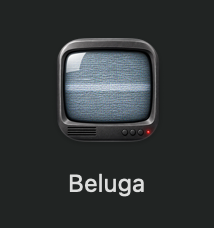
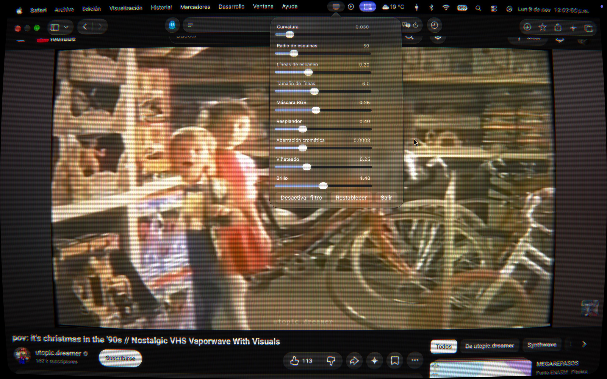

# 📺 Beluga

**A real-time CRT television effect for your entire Mac screen.**
Curved glass, scanlines, phosphor mask, glow and chromatic aberration, drawn on top of everything you do.

**Un efecto de tele CRT en tiempo real para toda la pantalla de tu Mac.**
Cristal curvo, scanlines, máscara de fósforo, brillo y aberración cromática, encima de todo lo que haces.

[🇬🇧 English](#-english) · [🇲🇽 Español](#-español)

  

---

# 🇬🇧 English

## What is it?

Beluga is a lightweight menu bar app for macOS. It captures your screen in real time and redraws it through a Metal shader that imitates an old CRT television. It is not a flat tint on top of the screen: the image itself is bent, blurred, glowing and split into phosphor dots, just like the real thing.

Your clicks go straight through the filter to the apps underneath, so you keep using your Mac normally.

## Features

- **Real filter, not a simple overlay.** The screen is captured with ScreenCaptureKit and processed on the GPU with Metal at up to 60 fps.
- **9 adjustable effects** with live sliders (see the table below).
- **Menu bar popover** with all the sliders, a **Disable/Enable Filter** button, **Reset** and **Quit**.
- **Settings are saved automatically** and restored the next time you open the app.
- **Works everywhere:** full-screen apps, every Space, context menus and popovers all get the filter.
- **Click-through:** mouse and trackpad events reach the apps below.
- **Multi-display support:** every connected display gets its own overlay, capture and renderer. Works with mirrored, extended and AirPlay displays, and rebuilds itself when you plug or unplug a screen.
- **Cursor drawn inside the filter.** The pointer is curved together with the image, so what you see lines up with what you click. It hides after 10 seconds of inactivity.
- **Zero cost when off.** *Disable Filter* stops the capture completely: no GPU load and the system's purple recording dot disappears.
- **Menu bar only.** No Dock icon and no windows.
- **Feedback-loop safe.** The app excludes its own overlay from the capture, so it never films itself.
- **Handles the system stopping the capture** (for example, "Stop Sharing") by turning the filter off cleanly.
- **Available in English and Spanish.** All interface text goes through `NSLocalizedString`.

## Effects

| Effect | What it does | Default | Range |
|---|---|---|---|
| Curvature | Bends the image like a CRT glass tube | 0.03 | 0 – 0.25 |
| Corner radius | Rounds the corners of the screen (in capture pixels) | 50 | 0 – 300 |
| Scanlines | Strength of the dark horizontal lines | 0.20 | 0 – 0.6 |
| Scanline size | Distance between scanlines (in capture pixels) | 6.0 | 2 – 12 |
| RGB mask | Red / green / blue phosphor column pattern | 0.25 | 0 – 0.6 |
| Glow | Bloom around bright areas | 0.40 | 0 – 1.5 |
| Chromatic aberration | Red and blue fringes, stronger toward the edges | 0.0008 | 0 – 0.003 |
| Vignette | Darkens the corners | 0.25 | 0 – 0.8 |
| Brightness | Compensates the light lost by the mask and scanlines | 1.40 | 0.8 – 2.0 |

## Requirements

- A Mac with Apple silicon or a Metal-capable GPU
- A recent version of macOS with ScreenCaptureKit (developed and tested on macOS 27)

## Installation

Download the latest **Beluga.dmg** from the [Releases page](https://github.com/alespoio/Beluga/releases), open it and drag **Beluga** to Applications. No need to build anything: the app is already signed.

1. The first time, macOS asks for **Screen Recording** permission. Go to **System Settings → Privacy & Security → Screen & System Audio Recording**, turn on **Beluga**, and run the app again.
2. A 📺 icon appears in the menu bar. Click it to open the controls.

## Usage

| Action | How |
|---|---|
| Open the controls | Click the 📺 icon in the menu bar |
| Adjust an effect | Drag its slider, the screen updates live |
| Turn the filter on or off | **Disable Filter / Enable Filter** button |
| Go back to the default look | **Reset** button |
| Close the app | **Quit** button |

## How it works

1. **ScreenCaptureKit** captures each display (without the app's own overlay and without the system's copy of the recording indicator).
2. The pointer is drawn onto the captured frame, so it follows the same distortion as the image.
3. A **Metal fragment shader** applies the effects in this order: curvature and rounded corners → chromatic aberration → bloom → scanlines → RGB mask → vignette → brightness.
4. The result is shown in a borderless, transparent, click-through window above everything else, one per display.

## Known limitations

- **The purple recording dot stays.** macOS shows it whenever an app captures the screen. It is a system privacy protection and cannot be hidden. The filter only removes the extra copy of the dot that would show up inside the filtered image, so you see just the real one.
- **Private APIs.** Hiding the real cursor uses private CoreGraphics functions (`CGSSetConnectionProperty`). They work today but Apple could change them in a future macOS release.
- **GPU usage grows with every display.** Each screen runs its own capture and shader. If it feels heavy, lower **Glow**.
- **Protected content** (some DRM video) may appear black, because macOS does not allow it to be captured.
- **The permission is tied to the build.** If you move or re-sign the app, macOS may ask for Screen Recording permission again.

## Roadmap

- [ ] Global keyboard shortcut to toggle the filter
- [ ] Launch at login (optional)
- [ ] Ready-to-download `.app` release
- [ ] Presets (green phosphor, amber, arcade, VHS)

## Contributing

Issues are welcome. If you open an issue, please include your macOS version and your displays setup (single, mirrored, extended, AirPlay).

## License

MIT. See [LICENSE](LICENSE).

---

# 🇲🇽 Español

## ¿Qué es?

Beluga es una app ligera de barra de menú para macOS. Captura tu pantalla en tiempo real y la vuelve a dibujar con un shader de Metal que imita una tele CRT antigua. No es un tinte plano encima de la pantalla: la imagen misma se curva, se difumina, brilla y se divide en puntos de fósforo, como en una tele de verdad.

Tus clics atraviesan el filtro y llegan a las apps de abajo, así que sigues usando tu Mac con normalidad.

## Características

- **Filtro real, no un simple overlay.** La pantalla se captura con ScreenCaptureKit y se procesa en la GPU con Metal hasta a 60 fps.
- **9 efectos ajustables** con sliders en vivo (mira la tabla más abajo).
- **Popover en la barra de menú** con todos los sliders, un botón **Disable/Enable Filter**, **Reset** y **Quit**.
- **Los ajustes se guardan solos** y se restauran la próxima vez que abres la app.
- **Funciona en todos lados:** apps en pantalla completa, todos los Spaces, menús contextuales y popovers también llevan el filtro.
- **Los clics lo atraviesan:** el mouse y el trackpad llegan a las apps de abajo.
- **Soporte para varias pantallas:** cada pantalla conectada tiene su propio overlay, captura y renderer. Funciona con pantallas en espejo, extendidas y por AirPlay, y se reconstruye solo cuando conectas o desconectas una.
- **Cursor dibujado dentro del filtro.** El puntero se curva junto con la imagen, así que lo que ves coincide con lo que picas. Se oculta tras 10 segundos sin actividad.
- **Costo cero cuando está apagado.** *Disable Filter* detiene la captura por completo: sin carga de GPU y el punto morado de grabación de macOS desaparece.
- **Solo barra de menú.** Sin icono en el Dock y sin ventanas.
- **A prueba de bucles.** La app excluye su propio overlay de la captura, así que nunca se graba a sí misma.
- **Maneja que el sistema detenga la captura** (por ejemplo, "Dejar de compartir") apagando el filtro de forma limpia.
- **Disponible en inglés y español.** Todo el texto de la interfaz pasa por `NSLocalizedString`.

## Efectos

| Efecto | Qué hace | Default | Rango |
|---|---|---|---|
| Curvature | Curva la imagen como el cristal de un tubo CRT | 0.03 | 0 – 0.25 |
| Corner radius | Redondea las esquinas de la pantalla (en píxeles de captura) | 50 | 0 – 300 |
| Scanlines | Intensidad de las líneas horizontales oscuras | 0.20 | 0 – 0.6 |
| Scanline size | Distancia entre scanlines (en píxeles de captura) | 6.0 | 2 – 12 |
| RGB mask | Patrón de columnas de fósforo rojo / verde / azul | 0.25 | 0 – 0.6 |
| Glow | Brillo (bloom) alrededor de las zonas claras | 0.40 | 0 – 1.5 |
| Chromatic aberration | Franjas rojas y azules, más fuertes hacia los bordes | 0.0008 | 0 – 0.003 |
| Vignette | Oscurece las esquinas | 0.25 | 0 – 0.8 |
| Brightness | Compensa la luz que quitan la máscara y las scanlines | 1.40 | 0.8 – 2.0 |

## Requisitos

- Una Mac con Apple silicon o con GPU compatible con Metal
- Una versión reciente de macOS con ScreenCaptureKit (desarrollada y probada en macOS 27)

## Instalación

Descarga el **Beluga.dmg** más reciente desde la [página de Releases](https://github.com/alespoio/Beluga/releases), ábrelo y arrastra **Beluga** a Aplicaciones. No hay que compilar nada: la app ya viene firmada.

1. La primera vez, macOS pide permiso de **Grabación de pantalla**. Ve a **Ajustes del Sistema → Privacidad y seguridad → Grabación de pantalla y audio del sistema**, activa **Beluga** y vuelve a ejecutar la app.
2. Aparece un icono 📺 en la barra de menú. Haz clic para abrir los controles.

## Uso

| Acción | Cómo |
|---|---|
| Abrir los controles | Clic en el icono 📺 de la barra de menú |
| Ajustar un efecto | Arrastra su slider, la pantalla se actualiza en vivo |
| Encender o apagar el filtro | Botón **Disable Filter / Enable Filter** |
| Volver al look por defecto | Botón **Reset** |
| Cerrar la app | Botón **Quit** |

## Cómo funciona

1. **ScreenCaptureKit** captura cada pantalla (sin el overlay de la propia app y sin la copia del indicador de grabación del sistema).
2. El puntero se dibuja sobre el frame capturado, así sigue la misma deformación que la imagen.
3. Un **fragment shader de Metal** aplica los efectos en este orden: curvatura y esquinas redondeadas → aberración cromática → bloom → scanlines → máscara RGB → viñeta → brillo.
4. El resultado se muestra en una ventana sin bordes, transparente y que deja pasar los clics, por encima de todo lo demás, una por pantalla.

## Limitaciones conocidas

- **El punto morado de grabación se queda.** macOS lo muestra siempre que una app captura la pantalla. Es una protección de privacidad del sistema y no se puede ocultar. El filtro solo quita la copia extra del punto que saldría dentro de la imagen filtrada, para que veas únicamente el real.
- **APIs privadas.** Para ocultar el cursor real se usan funciones privadas de CoreGraphics (`CGSSetConnectionProperty`). Hoy funcionan, pero Apple podría cambiarlas en una versión futura de macOS.
- **El uso de GPU crece con cada pantalla.** Cada pantalla corre su propia captura y su propio shader. Si se siente pesado, baja **Glow**.
- **El contenido protegido** (algunos videos con DRM) puede verse negro, porque macOS no permite capturarlo.
- **El permiso está ligado a la compilación.** Si mueves o vuelves a firmar la app, macOS puede pedir otra vez el permiso de Grabación de pantalla.

## Pendientes

- [ ] Atajo de teclado global para activar/desactivar el filtro
- [ ] Abrir al iniciar sesión (opcional)
- [ ] Versión `.app` lista para descargar
- [ ] Presets (fósforo verde, ámbar, arcade, VHS)

## Contribuir

Los issues son bienvenidos. Si abres un issue, incluye tu versión de macOS y cómo tienes tus pantallas (una sola, en espejo, extendida, AirPlay).

## Licencia

MIT. Mira [LICENSE](LICENSE).
